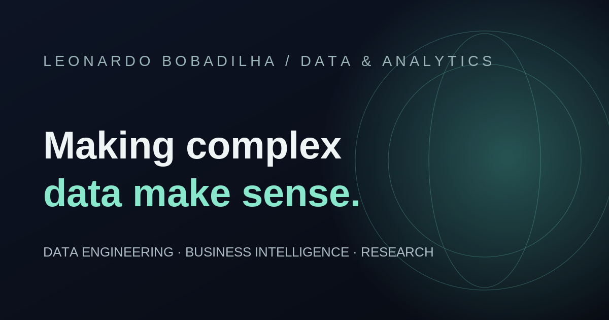

<!-- Portfolio repository: public-facing overview -->
<div align="center">
  

  # Leonardo Bobadilha · Data & Analytics

  **Independent work in data engineering, business intelligence and quantitative research.**

  A curated collection of projects focused on reliable data, transparent methods and useful visual experiences.

  **[Explore the portfolio](https://leobobadilha.github.io/)** &nbsp;·&nbsp; [LinkedIn](https://www.linkedin.com/in/leonardobobadilha/) &nbsp;·&nbsp; [GitHub profile](https://github.com/LeoBobadilha)
</div>

---

## Selected projects

### 01 / Workforce Analytics

**HR data integration · Business intelligence · Interactive reporting**

An end-to-end analytics experience combining three simulated HR data sources into a consistent workforce model. It includes validated metrics, six reporting dashboards, a geographic workforce explorer and documented data-quality checks.

**Focus:** Data integration, KPI definitions, reconciliation, interactive visualisation  
**Highlights:** Synthetic data · Python · JavaScript · Three.js

[**Explore live project**](https://leobobadilha.github.io/workforce-analytics-portfolio/) · [View source repository](https://github.com/LeoBobadilha/workforce-analytics-portfolio)

### 02 / Brazil Fixed Income Lab

**Government bonds · Pricing research · Data engineering**

An interactive research platform for Brazilian government bonds. An official-data pipeline powers bond exploration, mark-to-market scenarios, duration analysis, Renda+ simulations and macroeconomic context.

**Focus:** Data pipelines, pricing methodologies, data validation, financial analytics  
**Highlights:** Python · DuckDB · React · TypeScript · ECharts

[**Explore live project**](https://leobobadilha.github.io/brazil-fixed-income-lab/) · *The implementation repository is private.*

### 03 / Project Vortex

**Quantitative research · Systematic backtesting · Research communication**

A public-facing summary of research into rule-based price-action strategies. It presents historical experiments, costs, risk measures and a selected backtest benchmark while keeping the underlying trading system separate.

**Focus:** Research methodology, historical simulation, risk analysis, evidence presentation  
**Highlights:** Backtesting · Performance analytics · Data visualisation

[**Explore live project**](https://leobobadilha.github.io/project-vortex-portfolio/) · [View portfolio repository](https://github.com/LeoBobadilha/project-vortex-portfolio)

> **Research context:** Workforce Analytics uses synthetic records. The fixed-income tools include hypothetical financial scenarios. Project Vortex reports historical backtests, not verified live trading performance. None of these projects should be interpreted as financial advice.

---

## About this collection

I work with **SQL Server, Python, SSIS and Power BI** in business intelligence and data workflows, including transformation, validation, troubleshooting and reporting. These independent projects let me explore the same engineering principles across different domains: people analytics, fixed income and systematic trading research.

The website is intentionally a **project index**, not a recruitment page or a substitute for the more detailed project repositories.

## How the website is built

| Area | Implementation |
| --- | --- |
| Front end | Semantic HTML, custom CSS and vanilla JavaScript |
| Visual design | Responsive layouts, CSS-based 3D scene and motion-aware interactions |
| Deployment | GitHub Pages, served from `main` / repository root |
| Dependencies | No framework, bundler, application backend or paid API |
| Quality checks | Built-in Node.js checks for page structure, required assets and link integrity |

The project previews on the landing page are **illustrative artwork**, not live datasets or screenshots. Follow the project links to explore the actual reports and research.

### Project structure

```text
.
├── .github/workflows/    # Lightweight website quality checks
├── assets/               # Brand, favicon and social sharing artwork
├── docs/                 # Maintenance and publishing guidance
├── scripts/              # Dependency-free static checks
├── index.html            # Page content and project links
├── styles.css            # Visual design, layout and 3D effects
├── main.js               # Client-side interactions
└── README.md
```

### Run locally

```bash
python -m http.server 8000
```

Open [http://localhost:8000](http://localhost:8000). To run the automated checks (Node.js 20+):

```bash
node --check main.js
node scripts/check-site.mjs
```

Changes to `main` are published with GitHub Pages. For editing instructions, deployment notes and content safeguards, see [the maintenance guide](docs/MAINTENANCE.md).

---

<sub>© 2026 Leonardo Bobadilha · [Portfolio](https://leobobadilha.github.io/) · [LinkedIn](https://www.linkedin.com/in/leonardobobadilha/)</sub>
